<div align="center">

# NIGHT CITY MASASI

**Cyberpunk RED için çok oyunculu dijital masa**

Taktik harita · fizikli 3D zarlar · otomatik dövüş motoru · kritik yaralar · rol yetenekleri · hacklenebilir sistemler · senkron müzik · kampanya kaydı

[**▶ Oyna: orhunx.github.io/night-city-red-konsep**](https://orhunx.github.io/night-city-red-konsep/)


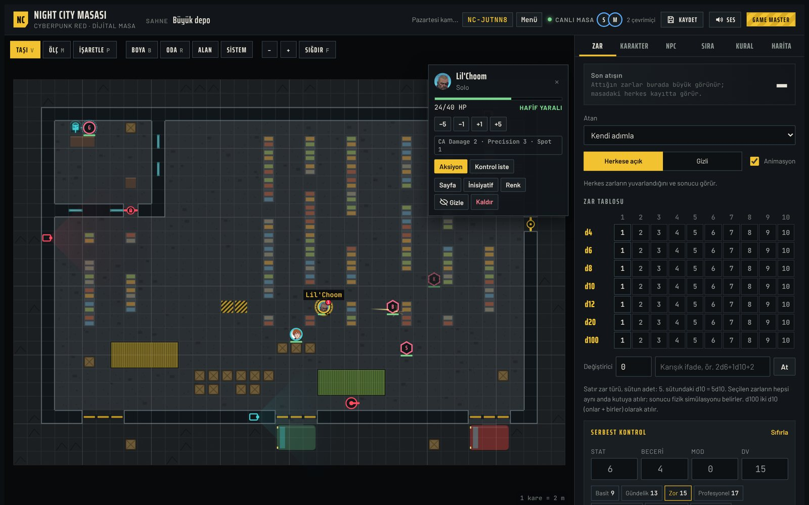

</div>

---

## İçindekiler

- [Ne bu?](#ne-bu)
- [Hızlı başlangıç](#hızlı-başlangıç)
- [Özellikler](#özellikler)
- [Karakter galerisi](#karakter-galerisi)
- [Kurulum (kendi Firebase projen)](#kurulum-kendi-firebase-projen)
- [Mimari](#mimari)
- [Geliştirme](#geliştirme)
- [Kısayollar](#kısayollar)
- [Bilinen sınırlar](#bilinen-sınırlar)
- [Telif ve teşekkür](#telif-ve-teşekkür)

## Ne bu?

Night City Masası, Cyberpunk RED oyununu arkadaşlarınla internet üzerinden, herkes kendi cihazından oynasın diye yapılmış tarayıcı tabanlı bir masa.

- **GM** bir oda kurar ve `NC-XXXXXX` biçiminde bir oda kodu alır.
- **Oyuncular** kodla ya da davet linkiyle katılır. Hesap açmak, uygulama kurmak gerekmez.
- Masada harita, karakterler, zarlar, kurallar ve müzik herkeste anlık olarak senkron kalır.

Kurallar Cyberpunk RED Core Rulebook'a göre ayarlandı: DV tabloları, menzil bantları, otomatik atış, zırhın aşınması, ağır ve ölümcül yara eşikleri, kritik yaralar, ölüm kurtarma zarı ve rol yetenekleri.

## Hızlı başlangıç

| | GM | Oyuncu |
|---|---|---|
| 1 | Siteyi aç, masada görünecek adını yaz | Siteyi ya da GM'nin gönderdiği davet linkini aç |
| 2 | **Oda kur** → odaya bir isim ver | **Odaya katıl** → `NC-XXXXXX` kodunu yaz |
| 3 | Lobide kodu veya davet linkini kopyalayıp gönder | Lobide kimlerin bağlı olduğunu gör |
| 4 | **Masaya gir** → Harita sekmesinden sahne üret, NPC koy | **Masaya gir** → Karakter sekmesinden karakterini oluştur, tokenini haritaya koy |
| 5 | Kaydet butonuyla kampanyanın anlık görüntüsünü al | Kendi tokenini sürükle; sağ tıkla (telefonda basılı tut) aksiyon menüsünü aç |

<table>
<tr>
<td width="50%">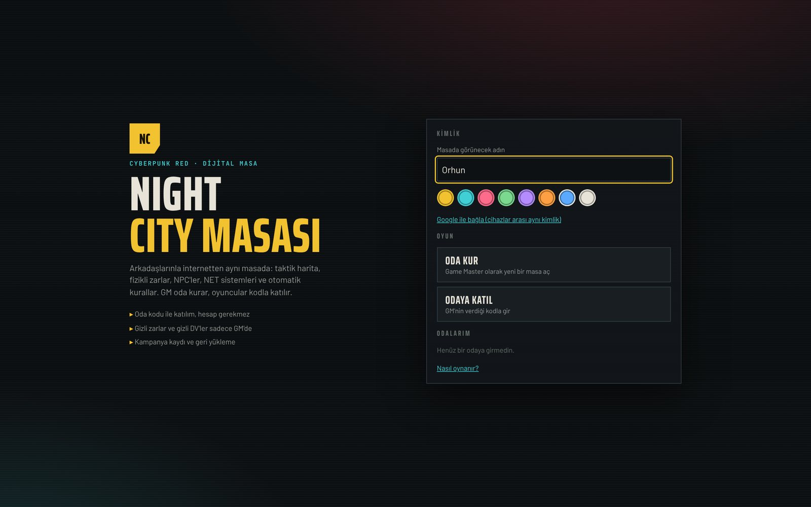</td>
<td width="50%">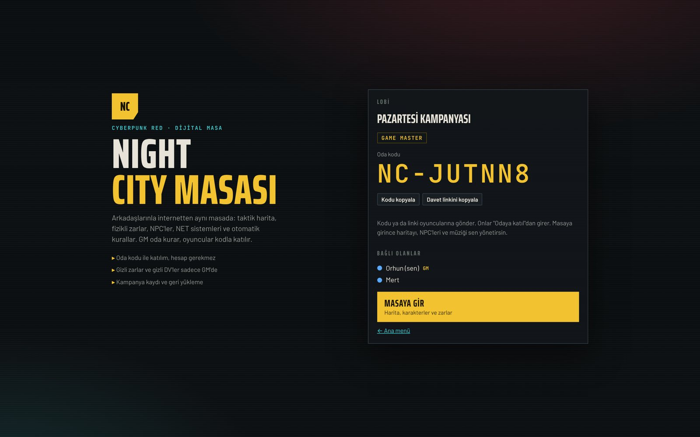</td>
</tr>
<tr>
<td align="center"><sub>Ana menü: kimlik, oda kur, odaya katıl, odalarım</sub></td>
<td align="center"><sub>Lobi: oda kodu, davet linki, bağlı olanlar</sub></td>
</tr>
</table>

## Özellikler

### Harita ve sahne üretici
- 8 sahne şablonu: depo, sokak, bar, ofis, liman, harabe, çatı, boş. Boyut, yoğunluk ve tohum ayarlanabilir; aynı tohum her zaman aynı haritayı verir.
- GM elle de çizebilir: karo fırçası, duvarlı oda, alan doldurma.
- Karoların siper değerleri kitaptan; ölçüm aracı, işaretleme (ping) ve hareket menzili (yürüme/koşu) var.
- NPC'ler oyunculardan gizlenebilir; gizli olanları sadece GM görür.

### Fizikli 3D zarlar
- d4'ten d100'e tüm zarlar, cannon.js ile gerçek fizik simülasyonuyla atılır. Sonucu simülasyon belirler ve aynı atış tüm oyunculara aynı şekilde oynatılır.
- Siberdeck temalı zar masası, arkada Matrix akan bir monitör. Kritik başarı ve kritik başarısızlıkta ayrı efektler var.
- **Gizli atış:** sonucu sadece atan oyuncu ve GM görür.
- Zar tablosundan 5d10 gibi çoklu atış ya da `2d6+1d10+3` gibi karışık ifadeler.

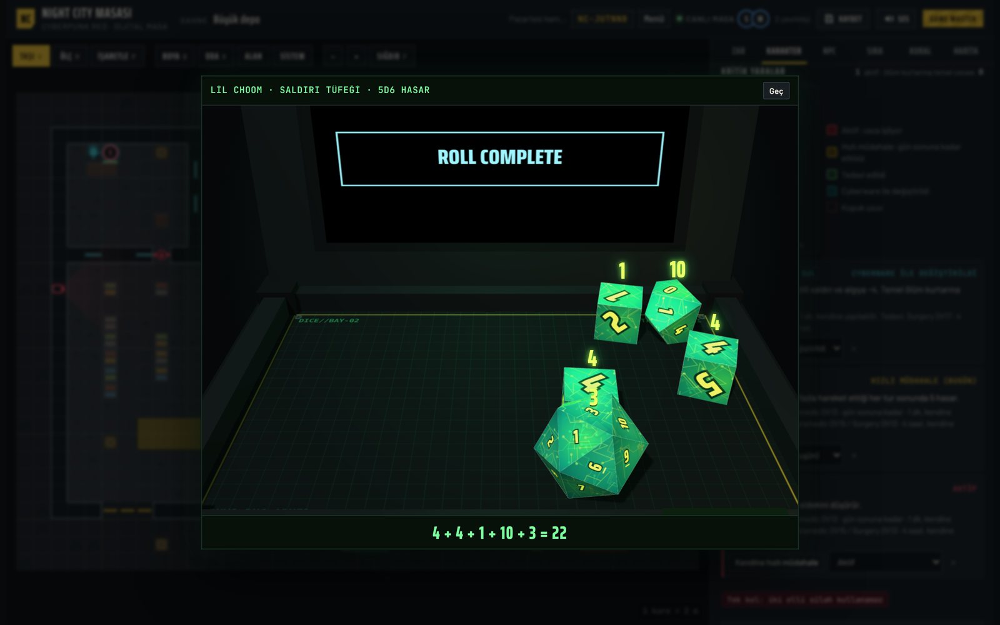

### Aksiyon motoru
Tokene sağ tıklayınca, karakter sayfasına göre hazırlanmış bir aksiyon menüsü açılır. Hesabı masa yapar:

- **Saldırılar:** tek atış, iki atış (ROF 2), nişanlı atış (kafa / bacak / eldeki silah), otomatik atış, bastırma ateşi, pompalı saçma, patlayıcı alanı, yakın dövüş, dövüş sanatları, boğuşma.
- **Savunma oyuncunun ekranına gelir.** REF 8 ve üstüyse "Kaçmayı dener misin?" kartı çıkar; DV oyuncuya gizli kalır.
- Zırh, yakın dövüşte yarım zırh, zırh aşınması, kafaya ×2 hasar, 2 tane 6 gelince kritik yara: hepsi otomatik.
- **Sosyal karşıt beceriler:** ikna, sorgu, kandırma, yankesicilik, yüzleşme.
- **GM kontrol isteği:** GM oyuncudan zar ister, DV gizli kalır, sonucu sadece GM görür.
- **LUCK** her zarda bir seçiciyle harcanabilir.
- Her aksiyonun haritada animasyonu ve sesi var: mermi izi, kesme, zincir, iyileşme ışığı, patlama ve ekran sarsıntısı.

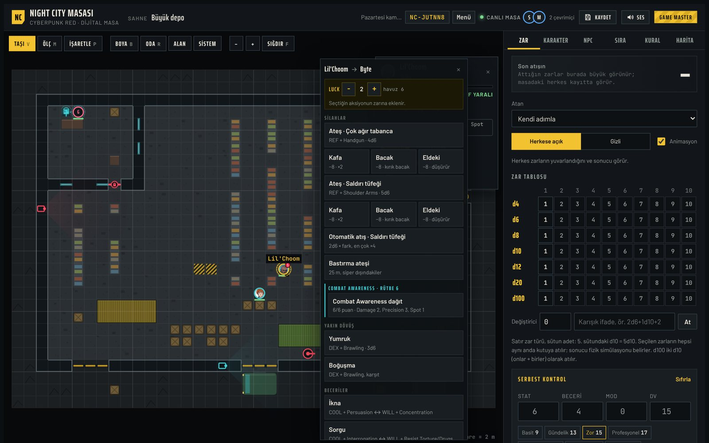

### Kritik yaralar ve vücut haritası
- Karakter sayfasında, yaralı bölgelerin renklendiği bir insan silüeti var. Kopan uzuvlar çarpıyla gösterilir, cyberware ile değiştirilen parçalar cyan görünür.
- Her yaranın durumu tutulur: aktif / hızlı müdahale (gün sonuna kadar) / tedavi edildi / cyberware ile değiştirildi.
- Cezalar ilgili zarlara kendiliğinden eklenir. Örneğin göz yarası menzilli saldırıyı, kırık çene konuşmayı etkiler; tek kolla iki elli silah kullanılamaz; kırık kaburgayla 4 m'den fazla yürüyen hasar alır.
- Hızlı müdahale ve tedavi aksiyon menüsünden yapılır. Tedavi kendine yapılamaz, Surgery sadece Medtech'e açıktır.

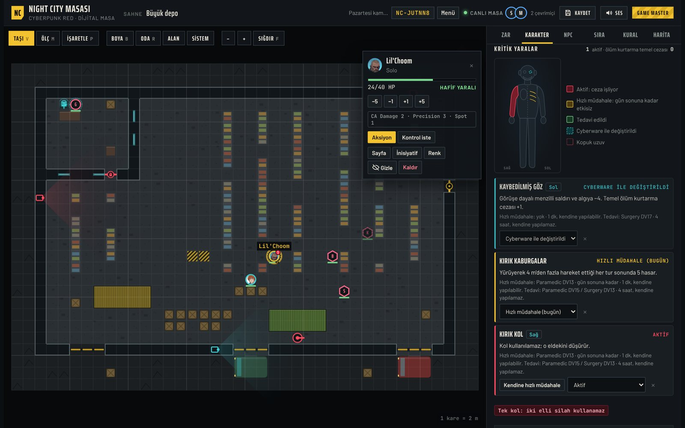

### Rol yetenekleri (dövüşte)
| Rol | Yetenek | Masada |
|---|---|---|
| Solo | Combat Awareness | Puan dağıtımı; Precision Attack, Spot Weakness, Damage Deflection, Fumble Recovery, Initiative Reaction, Threat Detection otomatik uygulanır |
| Netrunner | Interface | Jack In, Backdoor, Control, Scanner, Zap; tur başına NET aksiyonu sınırı |
| Medtech | Medicine | Speedheal, Stim, Rapidetox; günde bir kuralı, doz takibi |
| Tech | Maker | Zırha saha tamiri (kitaptaki tamir DV'leriyle), Field Expertise bonusu |
| Lawman | Backup | Destek çağrısı; ekip birkaç tur içinde harita kenarında belirir |
| Nomad | Moto | Aile aracı, manevra, çarpma (6d6 ve Whiplash) |

### Hacklenebilir sistemler (NET)
- Haritalara erişim noktası, güvenlik kamerası, güvenlik kapısı ve otomatik taret yerleştirilir. Harita üreticisi bunları kendisi koyar; GM elle de ekleyebilir.
- Netrunner erişim noktasına bağlanır, şifreyi kırar ve sistemi ele geçirir:
  - **Kamera:** görüş alanındaki gizli düşmanları açığa çıkarır ya da döngüye alınıp kör edilir.
  - **Kapı:** açılır, kapanır ya da kilitlenir; kilitli kapıdan geçilemez.
  - **Taret:** kendi tarafına çevrilip ateş ettirilir.
- Sistemin kimin kontrolünde olduğu haritada renkle görünür.

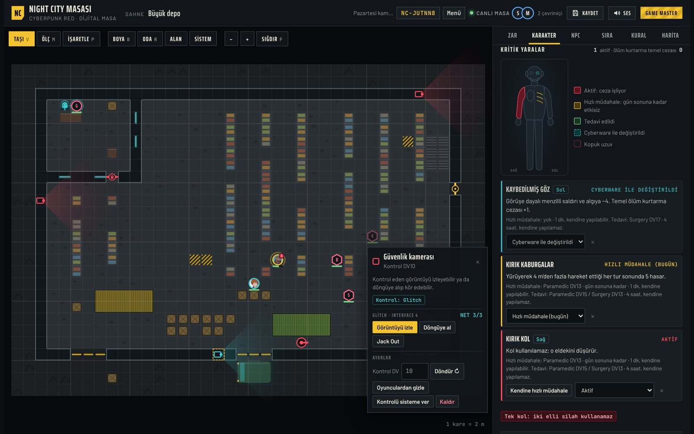

### Müzik ve ses
- 4 adet tarayıcıda sentezlenen cyberpunk parçası: sakin, gizli görev, aksiyon, gerilim.
- GM MP3 yükler; parçalar herkeste senkron çalar, sonradan katılan doğru yerden başlar. Çalma listesi, tekrar modları, kişisel ses seviyesi.
- SoundCloud, YouTube ve Spotify linkleri herkesin ekranına "yeni sekmede aç" kartı olarak gönderilir.
- Her silah ve aksiyonun kendi ses efekti var.

### Kampanya kaydı
- Masa her değişikliği otomatik kaydeder.
- GM'nin **Kaydet** butonu harita, tokenler, karakter ve NPC sayfaları, inisiyatif, sistemler ve müzikle birlikte anlık bir görüntü alır.
- Kayıtlar istenince geri yüklenir, `.json` dosyası olarak indirilir ve dosyadan geri getirilir.

## Karakter galerisi

Masada oynadığımız karakterlerden birkaçı:

<table>
<tr>
<td width="50%">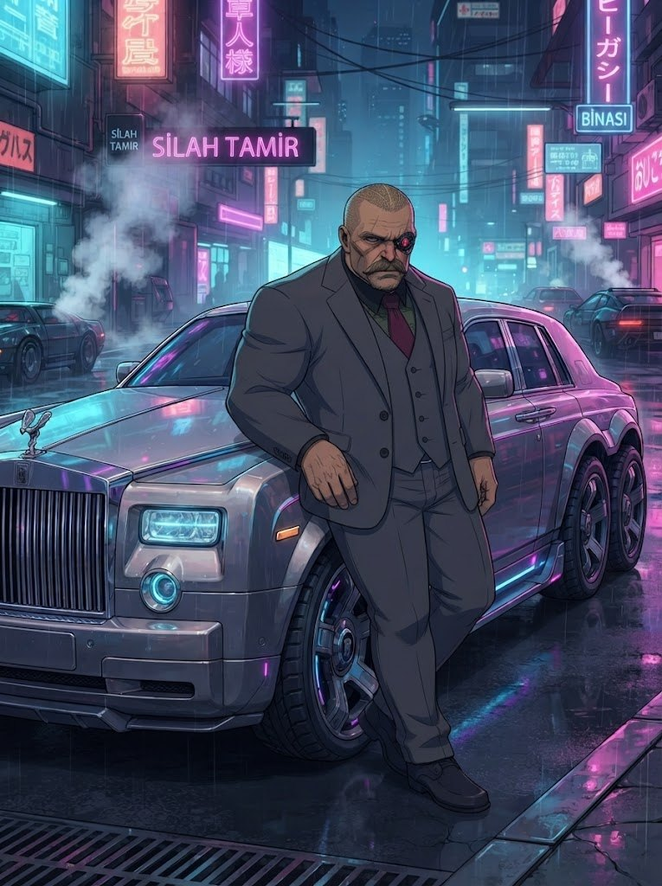</td>
<td width="50%">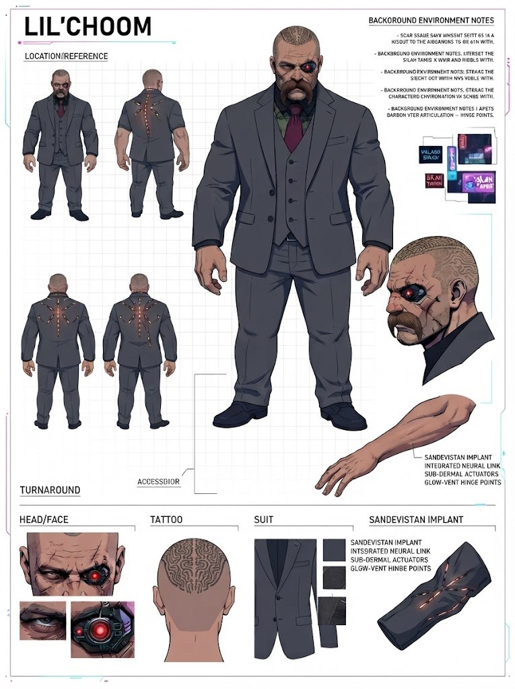</td>
</tr>
<tr>
<td align="center"><b>Lil'Choom</b><br><sub>Siber gözlü, Sandevistan implantlı, takım elbiseli bir sokak efsanesi</sub></td>
<td align="center"><sub>Tasarım sayfası: dönüş görünümleri, kafa dövmesi, siber göz, Sandevistan</sub></td>
</tr>
<tr>
<td width="50%">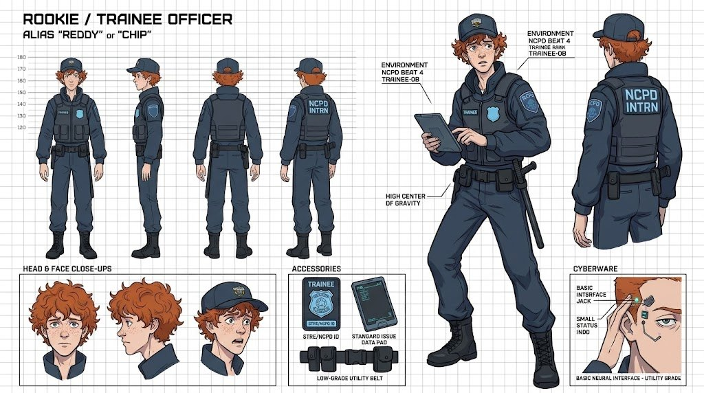</td>
<td width="50%">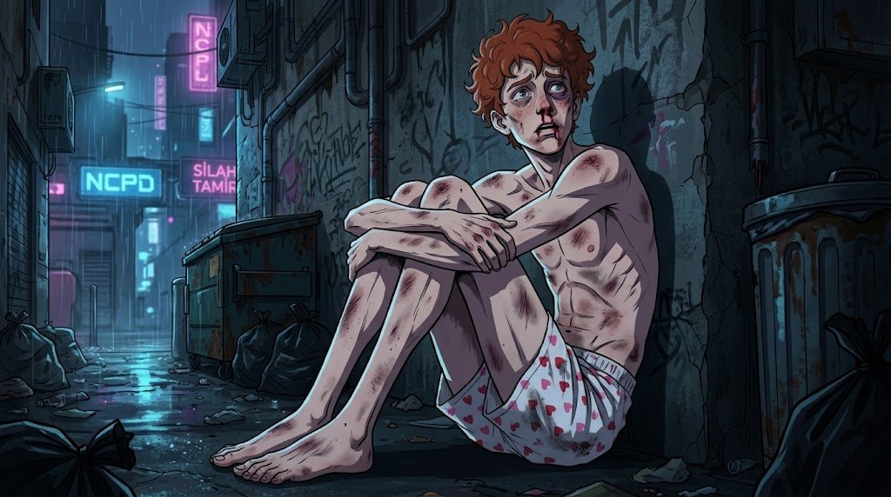</td>
</tr>
<tr>
<td align="center"><b>Reddy / "Chip"</b><br><sub>NCPD Beat 4 stajyeri; temel nöral arayüz, standart veri pedi</sub></td>
<td align="center"><sub>Night City ilk haftasında pek nazik davranmadı</sub></td>
</tr>
</table>

## Kurulum (kendi Firebase projen)

Site statik bir sayfa. Ortak veri, canlı olaylar ve kimlik Firebase'in ücretsiz Spark planıyla çalışıyor.

1. **Firebase projesi aç:** [console.firebase.google.com](https://console.firebase.google.com) → Proje ekle.
2. **Authentication → Sign-in method:** **Anonymous** açık olsun. İsteğe bağlı olarak **Google**'ı da aç; GM kimliğinin cihazlar arasında taşınması için gerekir.
3. **Authentication → Settings → Authorized domains:** sitenin alan adını ekle, örneğin `kullanici.github.io`.
4. **Firestore Database** oluştur: production mode, konum Avrupa.
5. **Realtime Database** oluştur: locked mode, konum `europe-west1`.
6. **Kuralları yükle:**
   - Firestore → Rules: [`firestore.rules`](firestore.rules) → Publish
   - Realtime Database → Rules: [`database.rules.json`](database.rules.json) → Publish
7. **Yapılandırma:** Proje ayarları → Web uygulaması → `firebaseConfig` değerlerini [`firebase-config.js`](firebase-config.js) dosyasına yaz. Bu değerler gizli değildir; güvenliği kurallar sağlar.
8. **GitHub Pages:** Settings → Pages → *Deploy from a branch* → `main` / `(root)`.

> Firebase Storage kullanılmıyor (yeni projelerde ücretli plan istiyor). MP3'ler ve portreler Firestore'da parçalara bölünerek saklanıyor.

## Mimari

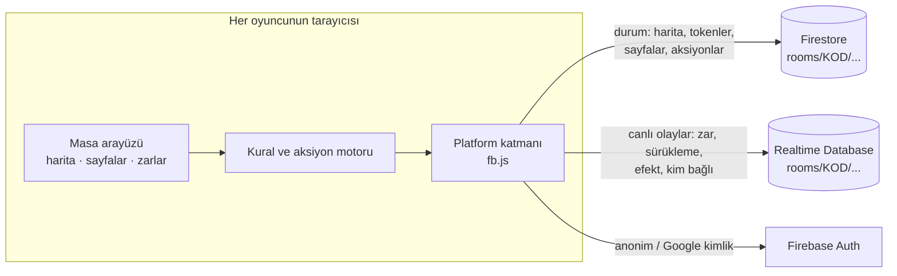

- **Her oda kendi alanında:** `rooms/<KOD>` altındaki koleksiyonlar `tokens`, `chars`, `npcs`, `hidden`, `act`, `req`, `rolls`, `table`, `dev`, `gm`, `saves` ve diğerleri.
- **GM'ye özel veriler:** NPC sayfaları, gizli tokenler, gizli DV'ler, kayıtlar ve başkalarının gizli zarları Firestore kurallarıyla sadece odanın GM'ine açıktır. Odayı kuran kişi GM olur.
- **Çok istemcili aksiyonlar:** her aksiyon bir belgedir. Saldıran zarını atar; savunan kendi cihazında savunur; NPC'leri GM'in cihazı çözer. Bir oyuncu 30 saniye cevap vermezse GM onun yerine çözebilir.
- **Deterministik zarlar:** zarı atan cihaz fiziği bir tohumla simüle eder; diğerleri aynı tohumla aynı yuvarlanmayı izler.
- Bağımlılık yok: vanilla JS. 3D için three.js r128 ve cannon.js 0.6.2 CDN'den yükleniyor.

## Geliştirme

```
src/
  shell.html          arayüz iskeleti ve stiller
  web_head.html       <head>: Firebase SDK
  web_start.html      başlangıç ekranı ve lobi
  gen.js              sahne üretici ve sistem yerleştirme
  data.js rules.js    statlar, beceriler, silahlar, zırhlar, olay rehberi
  injuries.js         kritik yaralar ve vücut haritası
  core.js             veri katmanı, karakter kuralları, zarlar
  dice3d.js           fizikli 3D zar masası
  map.js fx.js        harita çizimi, işaretçi, animasyonlar
  actions.js          aksiyon motoru, savunma kartları, GM istekleri
  net.js roles.js     NET sistemleri, rol yetenekleri
  audio.js music.js   ses efektleri, sentez müzik, MP3 listesi
  save.js             kampanya kaydı
  ui.js               sekmeler, sayfalar, başlatma
  fb.js               Firebase platform katmanı ve odalar
  build_web.sh        tek dosyalık ../index.html üretir
```

```sh
sh src/build_web.sh   # index.html dosyasını yeniden üretir
python3 -m http.server   # kökte yerel olarak dene: http://localhost:8000
```

## Kısayollar

| Tuş | İşlev |
|---|---|
| `V` | Taşı |
| `M` | Ölç |
| `P` | İşaretle (ping) |
| `B` / `R` | Boya / oda çiz (GM) |
| `F` | Haritayı sığdır |
| `Esc` | Menüyü, hedeflemeyi ya da seçimi kapat; zar animasyonunu geç |
| Sağ tık / basılı tut | Aksiyon menüsü |

## Bilinen sınırlar

- Netrunning hafif tutuldu: kat kat NET mimarisi, programlar ve Black ICE dövüşü yok.
- Rockerboy, Exec, Fixer ve Media'nın rol yetenekleri kitapta dövüş yeteneği olmadığı için dövüş menüsünde yer almıyor.
- GM anonim girişle oda kurup tarayıcı verilerini silerse GM yetkisini kaybeder. Bunu önlemek için Google ile bağlanmak gerekir.
- Oda kodunu bilen herkes odaya katılabilir; kodu sadece oyuncularınla paylaş.

## Telif ve teşekkür

Bu, hayranlar tarafından yapılmış, ticari olmayan bir oyun aracıdır. **Cyberpunk** ve **Cyberpunk RED**, R. Talsorian Games Inc.'in ticari markalarıdır. Bu proje R. Talsorian Games veya CD PROJEKT RED ile bağlantılı değildir ve onlar tarafından onaylanmamıştır. Oynamak için Cyberpunk RED Core Rulebook gerekir. Masa kitabın metnini kopyalamaz; yalnızca kuralların kısa Türkçe özetlerini içerir ve oyun sırasındaki hesapları kolaylaştırır.

Karakter görselleri bu masada oynayan grubun kendi karakterleridir.
